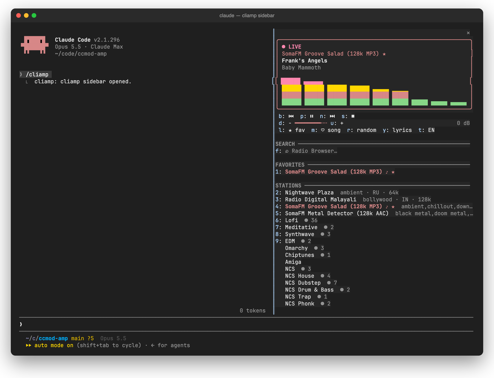
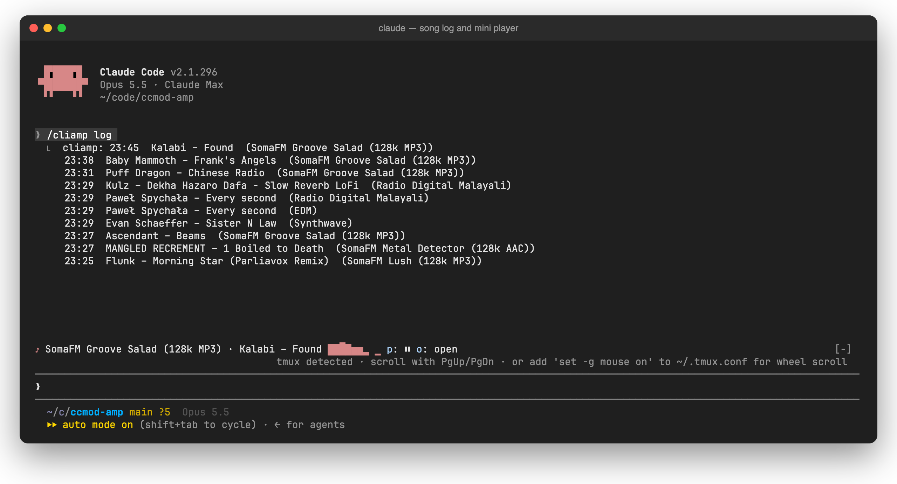
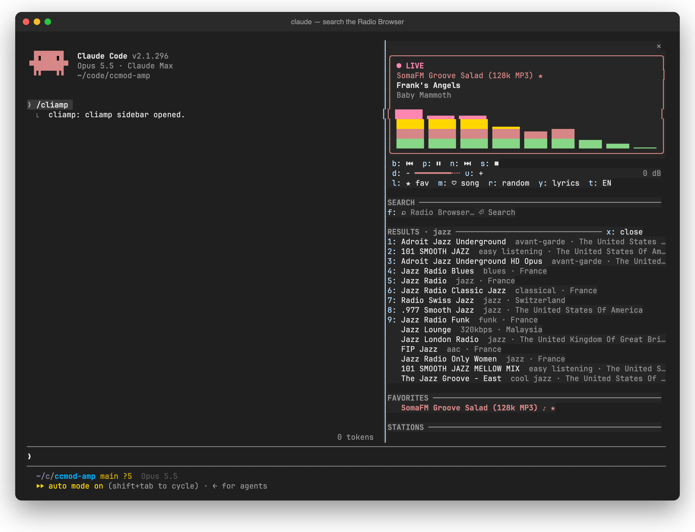
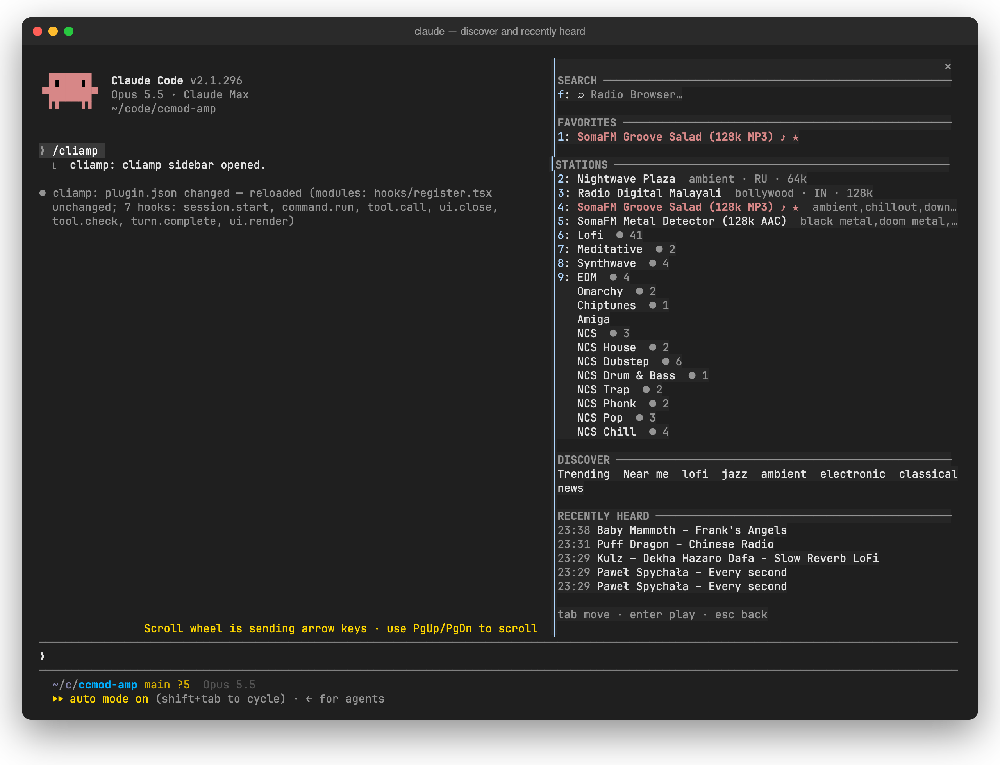
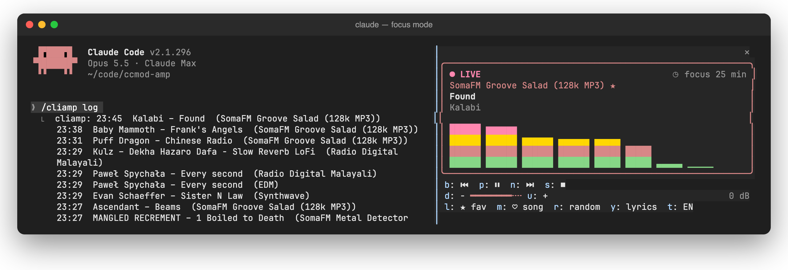
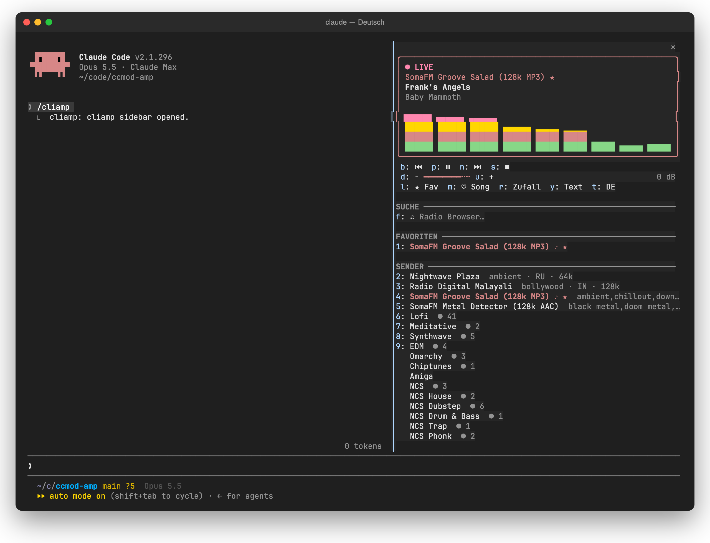

# ccmod-amp

**Internet radio inside Claude Code.** A [cliamp](https://github.com/bjarneo/cliamp) sidebar with a live equalizer, favorites, 58,000 stations to search, a mini player above the prompt, a song log, focus sessions, and music that gets out of the way when Claude needs you.



```
/plugin install cliamp --marketplace BjoernSchotte/ccmod-amp
```

[](LICENSE)


---

## Contents

- [Why](#why)
- [Requirements](#requirements)
- [Install](#install)
- [Quick start](#quick-start)
- [Feature guide](#feature-guide)
  - [The sidebar](#the-sidebar)
  - [The mini player](#the-mini-player)
  - [Favorites and your stations](#favorites-and-your-stations)
  - [Search](#search)
  - [Discover](#discover)
  - [Song log and hearts](#song-log-and-hearts)
  - [Lyrics](#lyrics)
  - [Focus mode](#focus-mode)
  - [Moods](#moods)
  - [Quiet when Claude needs you](#quiet-when-claude-needs-you)
  - [Ask Claude to DJ](#ask-claude-to-dj)
  - [Languages](#languages)
- [Keyboard reference](#keyboard-reference)
- [Slash commands](#slash-commands)
- [Configuration](#configuration)
- [How it works](#how-it-works)
- [Privacy and network](#privacy-and-network)
- [Troubleshooting](#troubleshooting)
- [Development](#development)
- [Credits](#credits)
- [License](#license)

---

## Why

You already live in Claude Code while you build. Switching windows to change a station breaks the flow you put the music on for. ccmod-amp puts the radio where you are:

- **Glanceable.** What's playing, on which station, with a live equalizer, without leaving the terminal.
- **Keyboard first.** Every control is one key once the sidebar has focus.
- **Aware of Claude.** The music dips when a turn finishes and gets quieter while Claude waits for your approval, so you notice.
- **Out of the way.** No cliamp on the machine? The mod stays dormant and registers nothing.

## Requirements

| | |
|---|---|
| **Claude Code** | 2.1.275 or later (mods with function hooks) |
| **cliamp** | 2.x on your `PATH`: `brew install bjarneo/cliamp/cliamp`, or see [cliamp's install guide](https://github.com/bjarneo/cliamp) |
| **A running player** | the cliamp TUI or `cliamp --daemon`. The sidebar can start the daemon for you |
| **Fullscreen layout** | for the docked sidebar. Elsewhere it opens inline above the prompt |

macOS and Linux. cliamp's IPC socket is local, so the mod controls the player on the machine Claude Code runs on.

## Install

At a Claude Code prompt:

```
/plugin install cliamp --marketplace BjoernSchotte/ccmod-amp
```

Answer `y` to add the marketplace and pick the **user** scope. The mod is active in that session at once and in every session after.

<details>
<summary>Run it from a clone instead</summary>

```sh
git clone https://github.com/BjoernSchotte/ccmod-amp
claude --plugin-dir ./ccmod-amp
```

Or name the folder in `CLAUDE_CODE_PLUGIN_DIRS` (the `env` block of `~/.claude/settings.json`) to load it in every session.
</details>

## Quick start

1. Start the player if it isn't running: `cliamp --daemon &` (or press `s` in the sidebar).
2. Type `/cliamp`. The sidebar docks beside your transcript and takes the keyboard.
3. Press a digit to play a station, `p` to pause, `u`/`d` for volume, `Esc` to go back to the prompt.

That's it. Everything below is optional.

---

## Feature guide

### The sidebar

`/cliamp` opens it. `Esc` hands the keyboard back to the prompt and leaves it open, `ctrl+x tab` gives it the keys again, and the `✕` closes it.

From top to bottom:

| Part | What it shows |
|---|---|
| **Now playing card** | `● LIVE`, `❚❚ PAUSED` or `■ STOPPED`; the station (★ when it's a favorite); the song in bold; the artist; a 4-row equalizer driven by cliamp's live spectrum. The border glows while music plays |
| **Badges** | `◷ focus 25 min` during a [focus session](#focus-mode), `● 41 listening` on cliamp's own channels |
| **Transport** | `b` ⏮ · `p` ⏯ · `n` ⏭ · `s` ⏹ |
| **Volume** | `d` − ━━━━━━━━╌╌ `u` + in 3 dB steps, from −30 dB to +6 dB |
| **Actions** | `l` ★ favorite station · `m` ♥ heart song · `r` random · `y` lyrics · `t` language |
| **Search, results** | see [Search](#search) |
| **Favorites, stations** | see [Favorites and your stations](#favorites-and-your-stations) |
| **Discover, recently heard** | see [Discover](#discover) and [Song log](#song-log-and-hearts) |

The digits `1`–`9` play the first nine rows as drawn, top to bottom: results first, then favorites, then your stations. Rows past nine are a `Tab` and `Enter` away.

When a stream fails, the sidebar shows `✗ Stream: …` with `w` to retry.

### The mini player

Close the sidebar and the radio stays visible: a one-line player sits above the prompt.



It reads `♪ station · artist – title ▃▅▇▆▄` and has its own controls. **Click it** to reopen the sidebar, or press `ctrl+x tab` and then `o`. `p` plays and pauses from there too. It hides itself while nothing plays.

Prefer Claude Code's status line? Set [`statusline`](#configuration) to `full`, `title` or `spectrum`.

### Favorites and your stations

- **Favorite** the station that's playing with `l`. It lands in **FAVORITES** at the top of the sidebar and gets a ★ everywhere. Press `l` again to remove it.
- On first start the mod takes over the radio favorites you already saved in cliamp.
- **STATIONS** lists the last eight stations you picked from search or discovery, then cliamp's own channels (Lofi, Synthwave, NCS …) with live listener counts.
- Favorites, picked stations and the song log survive restarts: they live in the mod's own store.

### Search

Press `f`, type, `Enter`. The sidebar searches the [Radio Browser](https://www.radio-browser.info/) directory through cliamp and lists up to 15 stations with genre and country.



- Pick one with its digit or `Enter`: it plays, the results close, and the station joins **STATIONS** for next time.
- `x` closes the results without playing anything.

### Discover

At the bottom of the sidebar: **Trending**, **Near me** (Germany with the German UI, the US otherwise), and the tags **lofi**, **jazz**, **ambient**, **electronic**, **classical** and **news**. Each opens the 15 most-listened stations as results.



### Song log and hearts

Every song the stream announces is logged with time, artist, title and station, newest first, up to 200 songs.

- **RECENTLY HEARD** at the bottom of the sidebar shows the last five.
- `/cliamp log` prints the last 25 into the transcript.
- `m` hearts the song that's playing (♥ in the card and in the log). It's the "what was that track?" button.
- `/cliamp now` copies `artist – title` to the clipboard.

### Lyrics

`y` opens a **LYRICS** section under the controls when cliamp finds lyrics for the song, and `y` again closes it. Live radio often has none, and the section says so.

### Focus mode

```
/cliamp focus        # 50 minutes
/cliamp focus 25     # 25 minutes
/cliamp focus off
```

Focus mode starts Lofi if nothing plays and shows a `◷ focus 25 min` countdown in the card. When the time is up it fades the music out over a few seconds, stops, restores the volume and tells you with a toast. The timer survives a restart of Claude Code.



### Moods

```
/cliamp mood debug
```

Plays the station mapped to a mood. The defaults:

| Mood | Station |
|---|---|
| `focus` | Lofi |
| `calm` | Meditative |
| `debug` | Meditative |
| `refactor` | Synthwave |
| `ship` | EDM |
| `retro` | Amiga |

Map your own in [`moods`](#configuration), for example `focus=Lofi;deploy=SomaFM Groove Salad`. A mood names any station: a favorite, a picked one, a cliamp channel, or a Radio Browser search term.

### Quiet when Claude needs you

- **Permission prompts:** while Claude waits for your approval, the music is 12 dB quieter, and it comes back the moment you answer. Prompts that an auto-mode classifier or a rule answers within 1.5 s never touch the volume.
- **Turn end:** a short dip when Claude finishes, so you hear it's your turn.

Both are on by default and can be switched off under [Configuration](#configuration). The volume to return to is saved, so even a crash mid-duck never leaves your music quiet.

### Ask Claude to DJ

The mod gives Claude a `radio` tool. Just ask:

> what's playing?
>
> put on something calm, I'm debugging
>
> skip this one · louder · favorite this station

Claude can read what's playing, play a station by name, genre or mood, pause, resume, skip, set the volume and favorite the station.

### Languages

English and German. The mod follows Claude Code's `language` setting (`"language": "german"` gives you Deutsch); any other setting, or none, gives English.



Switch any time with `t` in the sidebar or `/cliamp lang de|en`. Your choice is kept; `/cliamp lang auto` follows Claude's setting again.

---

## Keyboard reference

While the sidebar has the keyboard (`/cliamp`, or `ctrl+x tab`):

| Key | Action | Key | Action |
|---|---|---|---|
| `p` | play / pause | `l` | favorite station |
| `n` | next | `m` | heart song |
| `b` | previous | `r` | random station |
| `s` | stop (start the daemon when it's not running) | `y` | lyrics |
| `u` | volume +3 dB | `t` | EN / DE |
| `d` | volume −3 dB | `w` | retry a failed stream |
| `1`–`9` | play that row | `f` | search |
| `x` | close results | `Tab` / `Enter` | move / play any row |
| `↑` `↓` | scroll | `Esc` | back to the prompt |

Mini player (the band above the prompt, `ctrl+x tab`): `p` play/pause, `o` open the sidebar.

## Slash commands

| Command | Does |
|---|---|
| `/cliamp` | open the sidebar |
| `/cliamp now` | copy `artist – title` to the clipboard |
| `/cliamp log` | the last 25 songs |
| `/cliamp focus [minutes\|off]` | focus session, 50 minutes by default |
| `/cliamp mood <name>` | play a mood's station |
| `/cliamp lang de\|en\|auto` | UI language |

## Configuration

`/config` lists the mod's options. Claude Code keeps them in `~/.claude/settings.json` under `pluginConfigs`.

| Option | Default | |
|---|---|---|
| `statusline` | `off` | `off`, `full`, `title` or `spectrum` in Claude Code's status line (the mini player shows it already) |
| `duckOnAsk` | `true` | 12 dB quieter while Claude waits for your approval |
| `dipOnTurnEnd` | `true` | a short dip when a turn ends |
| `autostart` | `false` | start `cliamp --daemon` when the sidebar opens or a station is chosen |
| `moods` | see [Moods](#moods) | `mood=station` pairs separated by `;` |

## How it works

```
Claude Code ── hooks module (register.tsx) ──┬── cliamp remote call …     playback, search, volume
                                             ├── cliamp remote events …   state changes, pushed
                                             ├── cliamp visstream         spectrum, 8 fps while playing
                                             └── HTTPS                    Radio Browser, listener counts
```

- One Claude Code mod built on function hooks: a sidebar `Pane`, the band above the prompt, a slash command, a tool, and hooks on `tool.check`, `tool.call` and `turn.complete` for the ducking.
- Every control is a cliamp V2 IPC operation through its CLI. State changes arrive as events; a 10 s poll only notices the player coming and going.
- Favorites, picked stations, the song log, the language and a running focus timer live in the mod's store. What the UI draws lives in session state, so a hot reload or `/clear` keeps it.

## Privacy and network

The mod talks to the cliamp player on your machine and, for discovery and listener counts only, to:

- `all.api.radio-browser.info`: the public Radio Browser API (Trending, Near me, tags)
- `radio.cliamp.stream/statistics`: live listener counts for cliamp's channels

Search goes through cliamp itself. Nothing is sent anywhere else, and the song log stays local. "Near me" uses the UI language, not your location.

## Troubleshooting

| Symptom | Fix |
|---|---|
| `/cliamp` is unknown | `cliamp` is not on Claude Code's `PATH`, so the mod stays dormant. Check `cliamp --version` in the shell you start Claude Code from |
| "cliamp is not running" | press `s`, run `cliamp --daemon &`, or turn on `autostart` |
| The sidebar opens inline, not docked | the docked sidebar needs the fullscreen layout and about 110 columns |
| Hotkeys type into the search field | the field has focus: `Esc`, then `ctrl+x tab` |
| The sidebar is too wide | drag its edge; Claude Code remembers your width |
| No equalizer | cliamp only reports a spectrum while it plays |
| Listener counts missing | `radio.cliamp.stream` was unreachable; they come back within three minutes |

## Development

```sh
claude plugin validate .     # what the module hooks and calls, and anything the engine would refuse
claude plugin test .         # helpers, the search flow, the ducking race
claude --plugin-dir .        # run it; saving a file hot-reloads the mod
```

`tsc -p .` type-checks the mod once Claude Code has loaded it and laid its types into `.claude-plugin/types/`.

`hooks/register.tsx` is the whole mod, `types/index.d.ts` declares its session state, `hooks/*.test.ts` are the tests, and `docs/screenshots/` are real captures of Claude Code in a terminal.

Issues and pull requests are welcome.

## Credits

- [cliamp](https://github.com/bjarneo/cliamp) by Bjarne Øverli: the retro terminal player doing all the audio
- [Radio Browser](https://www.radio-browser.info/): the community station directory
- [SomaFM](https://somafm.com/) and cliamp radio for the music in the screenshots

## License

[Apache License 2.0](LICENSE) © 2026 Björn Schotte
